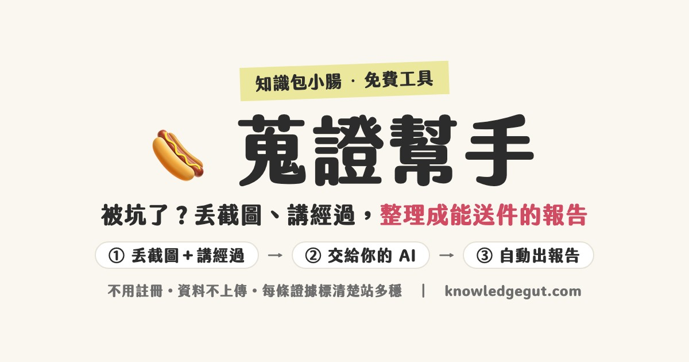

<!--
  知識包小腸 knowledgegut.com
  © 2026 知識包小腸（小腸老師）· 保留一切權利
  這是「小腸老師」原創的免費工具：歡迎原封不動轉給需要的人、分享連結。
  未經同意，請勿轉售、拿掉署名改成自己的產品，或拿去對第三方收費提供服務。
  ⟪ KG-SRC-2026-10 ⟫ 本檔內含來源識別碼，流通路徑可回溯。
-->

# 🌭 蒐證幫手｜被坑了？丟截圖、講經過，整理成能送件的報告

被爛平台、爛店、培訓營坑了，氣到不知道從哪裡開始？
把截圖丟進來、用你自己的話講經過，交給你習慣用的 AI 整理，**自動生成一份有條理、能送件的報告 PDF**。

每條證據都會標清楚「站多穩」，**幫你整理證據討公道，不讓你一時氣憤告過頭、反被咬。**

這是「小腸老師」（知識包小腸，AI 第二大腦應用師）做的免費工具。

---

## 👉 最快：直接用線上版

**https://knowledgegut.com/evidence**

手機、電腦都能開，不用註冊、不用下載。

---

## 🎬 先看 40 秒示範

[▶️ 看示範影片（demo/evidence-helper-demo.mp4）](demo/evidence-helper-demo.mp4)

示範裡的案例是虛構的，換成你自己的截圖和經過，就會做出你的報告。

---

## 🧭 怎麼用（三步）

1. **丟截圖＋講經過**：截圖照時間順序放（對方的承諾、付款紀錄、對方推託的話），經過不用整理，像跟朋友抱怨一樣講就好。
2. **交給你的 AI**：按一下就複製一段整理指令，貼給你平常用的 AI（ChatGPT、Gemini、Claude、豆包都可以），再把截圖丟給它。
3. **貼回來，自動出報告**：把 AI 的回覆整段貼回來，報告就出來了。逐句核對沒問題，就印成 PDF 送出。

---

## 💾 想離線用：下載到自己的電腦

1. 按這頁上方綠色的 **Code** → **Download ZIP**
2. 解壓縮，用瀏覽器打開 `index.html`
3. 不用安裝任何東西，斷網也能用

---

## 🔒 你的資料去哪了？

- **哪裡都沒去。** 這個網頁沒有伺服器，技術上也禁止對外傳資料。
- 截圖和內容只留在你自己的手機／電腦；草稿暫存在這台裝置，按「清空」就刪掉。
- 整理那一步，是**你自己**把截圖交給**你自己選的** AI。

---

## ⚠️ 開始前先知道

- **這是整理工具，不是法律意見。** AI 會看錯、寫錯，報告送出前請逐句核對，跟事實不符的一定要改。
- **報告是「送件用」，不是「公審用」。** 交給官方、平台、律師或對方本人討公道就好；公開張貼、群組轉發、對帳號公審，就算你是受害者，也可能反過來構成妨害名譽。
- 要報案、提告，請洽主管機關或律師。

---

## 📜 授權

免費使用，歡迎原封不動轉給需要的人。**不可以轉售、拿掉署名改成自己的產品、拿去對別人收費提供服務。** 詳見 [LICENSE](LICENSE)。

---

## 🙋 關於做這個工具的人

我是小腸，知識包小腸的「小腸老師」，教大家用 AI 打造自己的第二大腦。
想打造數位第二大腦，或對這個工具有建議，歡迎 LINE 找我：**@438rtpyd**（https://line.me/R/ti/p/@438rtpyd）

部落格：https://knowledgegut.com/

---

蒐證幫手｜知識包小腸 knowledgegut.com · © 2026 · ⟪ KG-SRC-2026-10 ⟫
